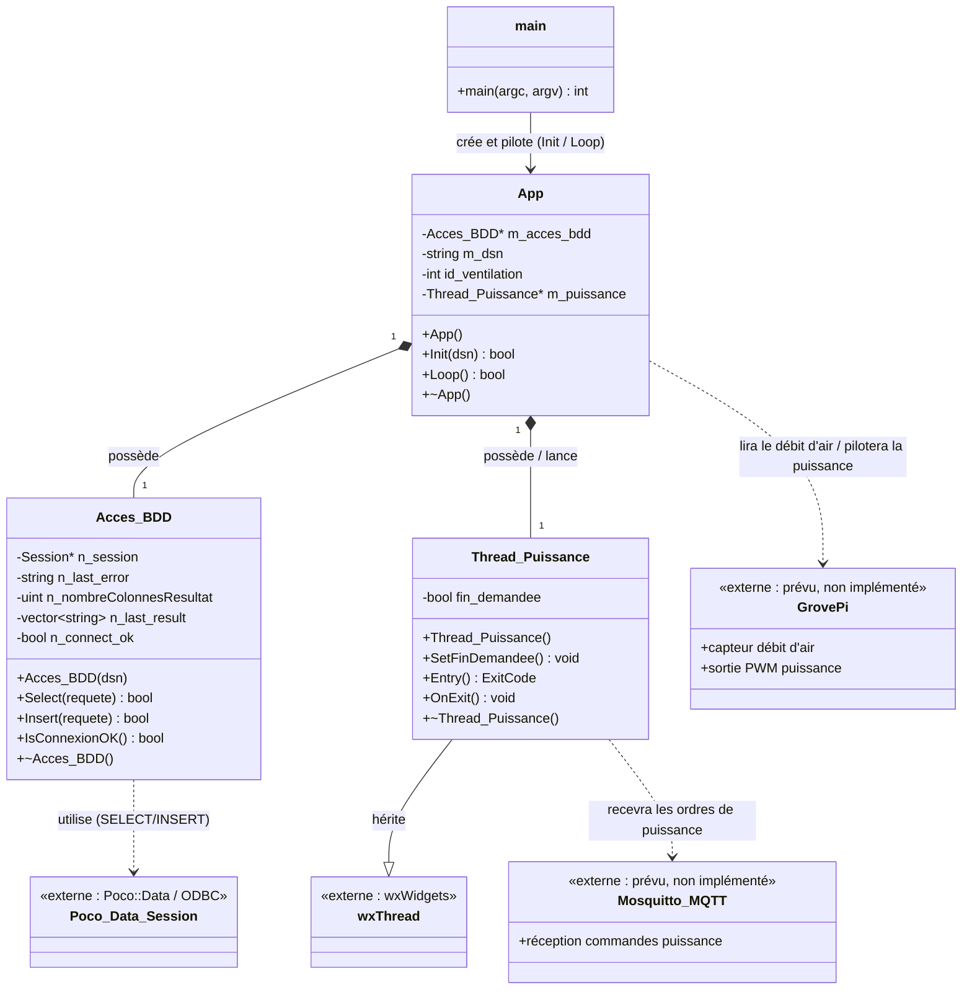

# Projet_2022_2023_Ventilation_ERP

Module ERP embarqué en C++ pour la supervision et le pilotage à distance d'un système de ventilation.

## Objectif du projet

Ce programme a été conçu pour un système ERP de gestion de ventilation avec deux missions principales :

1. **Récupérer le débit d'air** produit par la ventilation, via un capteur relié à une carte GrovePi+ (broche `PIN_DEBIT_AIR`).
2. **Gérer la puissance de la ventilation à distance**, via le protocole **MQTT** (bibliothèque **Mosquitto**), avec pilotage physique de la puissance en sortie (PWM, broche `PIN_PUISSANCE`).

L'ensemble des événements (connexions, démarrage/arrêt, changements de puissance) et des données mesurées (débit d'air, puissance) est **historisé dans une base de données** via un accès ODBC, afin de conserver une traçabilité complète du fonctionnement du système.

En résumé, le programme joue le rôle d'agent embarqué : il lit l'état physique de la ventilation, expose/reçoit des commandes de puissance à distance (MQTT), et journalise tout dans une base de données pour permettre un suivi historique côté ERP.

## Contexte et état d'avancement

Ce projet est un **prototype / preuve de concept** développé dans le cadre scolaire 2022-2023. Le squelette applicatif (chargement de la configuration, connexion BDD, thread de gestion de la puissance) est fonctionnel, mais plusieurs modules matériels et réseau sont **préparés mais non finalisés** dans le code (visibles en commentaires) :

- `//#include <grovepi.h>` et les appels `initGrovePi()`, `pinMode(...)` : intégration GrovePi+ prévue pour lire le débit d'air et piloter la puissance, pas encore activée.
- `//#include <Mosquitto.h>` dans `Thread_Puissance.h` : le thread de puissance est prévu pour embarquer un client MQTT Mosquitto assurant la réception des ordres de puissance à distance ; pour l'instant il exécute une boucle de test (compteur avec `Sleep`).
- Les commentaires `VOIR MODULE PWM`, `VOIR MODULE MOSQUITTO`, `VOIR MODULE GROVEPI+` dans `App.cpp` marquent les points d'intégration restants.

## Architecture technique

| Brique | Rôle | Statut |
|---|---|---|
| **wxWidgets** (`wxThread`) | Gestion du threading applicatif (thread dédié à la puissance) | Implémenté |
| **Poco::Data / Poco::Data::ODBC** | Accès à la base de données (SELECT / INSERT) via une source ODBC | Implémenté |
| **GrovePi+** | Lecture du capteur de débit d'air, pilotage PWM de la puissance | Prévu (code commenté) |
| **Mosquitto (MQTT)** | Réception à distance des commandes de puissance | Prévu (code commenté) |

La base de données est atteinte via un DSN ODBC nommé `RKBDD` (voir `main.cpp`), ce qui laisse le choix du SGBD (MySQL, PostgreSQL, SQL Server, etc.) libre côté configuration système, tant qu'un pilote ODBC compatible est installé.

## Structure du dépôt

```
Projet_ERP_Ventilation/
├── main.cpp                    # Point d'entrée de l'application
├── App.h / App.cpp             # Orchestrateur applicatif
├── Acces_BDD.h / Acces_BDD.cpp # Couche d'accès à la base de données (ODBC/Poco)
├── Thread_Puissance.h/.cpp     # Thread de gestion de la puissance (MQTT prévu)
├── Projet_ERP_Ventilation.project  # Fichier de projet Code::Blocks
└── Projet_ERP_Ventilation.mk       # Makefile généré par Code::Blocks
```

## Diagramme de classes



## Description des classes

### `main.cpp`
Point d'entrée du programme. Il initialise l'environnement **wxWidgets** (`wxInitializer`), définit le DSN de connexion à la base (`"RKBDD"`), instancie `App`, puis appelle successivement `App::Init()` (phase de démarrage) et `App::Loop()` (boucle de fonctionnement).

### `App`
Classe orchestratrice de l'application. Elle ne contient pas la logique métier fine mais **assemble et démarre** les différents composants :

- `Init(string &dsn)` : affiche le déroulé d'initialisation, ouvre la connexion à la base de données via `Acces_BDD`, crée et démarre le thread `Thread_Puissance` (thread détaché de gestion de la puissance), puis prépare (en commentaire, non actif) l'initialisation du module GrovePi+ (capteur de débit d'air sur `PIN_DEBIT_AIR`, sortie puissance sur `PIN_PUISSANCE`).
- `Loop()` : boucle principale de vie de l'application (actuellement une boucle d'attente active ; du code commenté montre l'intention initiale de synchroniser proprement l'arrêt d'un thread joignable).
- Attributs : pointeur vers l'accès BDD (`m_acces_bdd`), le DSN utilisé (`m_dsn`), un identifiant de ventilation (`id_ventilation`, prévu pour distinguer plusieurs unités de ventilation en BDD) et le thread de puissance (`m_puissance`).

### `Acces_BDD`
Couche d'accès aux données, basée sur **Poco::Data** avec le connecteur **ODBC** (`Poco::Data::ODBC::Connector`). C'est elle qui permet de sauvegarder l'historique des événements et des mesures (débit d'air, puissance) dans la base :

- Le constructeur `Acces_BDD(string dsn)` enregistre le connecteur ODBC et ouvre une `Session` Poco sur la source `DSN=<dsn>` ; en cas d'échec (`ConnectionFailedException`), l'erreur est mémorisée et `n_connect_ok` passe à `false`.
- `Select(string requete)` exécute une requête SQL de lecture, parcourt le `RecordSet` résultat et stocke chaque valeur convertie en `string` dans `n_last_result` (résultat "à plat", colonne par colonne, ligne par ligne).
- `Insert(string requete)` exécute une requête SQL d'écriture (utilisée pour journaliser les événements et les données mesurées).
- `IsConnexionOK()` indique si la connexion à la base est opérationnelle.
- Toute erreur ODBC (`ODBC::StatementException`) est interceptée et stockée dans `n_last_error` plutôt que de faire planter l'application.

### `Thread_Puissance`
Thread dédié à la **gestion de la puissance de la ventilation**, implémenté en héritant de `wxThread` (mode `wxTHREAD_JOINABLE`). C'est le point d'intégration prévu pour le client **MQTT (Mosquitto)** qui recevrait à distance les consignes de puissance à appliquer à la ventilation :

- `Entry()` est le corps du thread : tant que `fin_demandee` est faux, il boucle (actuellement une simple temporisation `Sleep(500)` avec affichage, en lieu et place de la future boucle d'écoute Mosquitto / mise à jour de la puissance).
- `SetFinDemandee()` permet de demander l'arrêt propre du thread depuis l'extérieur (ex. depuis `App`).
- `OnExit()` est appelé automatiquement par wxWidgets à la sortie du thread (log de fin).
- Le thread est créé puis démarré dans `App::Init()` via `Create()` puis `Run()`.

## Dépendances

- **wxWidgets** (threading, `wxThread`, `wxInitializer`)
- **Poco** — `PocoFoundation`, `PocoData`, `PocoDataODBC`
- Un **pilote ODBC** configuré côté système, avec un DSN nommé `RKBDD` pointant vers la base de données cible
- *(Prévu, non encore intégré au build)* : **GrovePi+** (capteurs/PWM) et **Mosquitto** (client MQTT)

## Compilation

Le projet a été développé avec **Code::Blocks** (`Projet_ERP_Ventilation.project` / `.mk`), en utilisant `wx-config` pour les flags de compilation/édition de liens de wxWidgets, et en liant les bibliothèques Poco (`PocoDataODBC`, `PocoData`, `PocoFoundation`).

## Pistes d'évolution

- Finaliser l'intégration GrovePi+ pour la lecture réelle du débit d'air et la commande PWM de la puissance.
- Intégrer un client Mosquitto dans `Thread_Puissance` pour recevoir les consignes de puissance à distance et les appliquer.
- Historiser systématiquement en base (via `Acces_BDD::Insert`) chaque événement (démarrage, arrêt, erreur) et chaque mesure (débit d'air, puissance appliquée) avec horodatage.
- Gérer proprement l'arrêt du thread `Thread_Puissance` depuis `App::Loop()` (le code de synchronisation existe déjà en commentaire).
